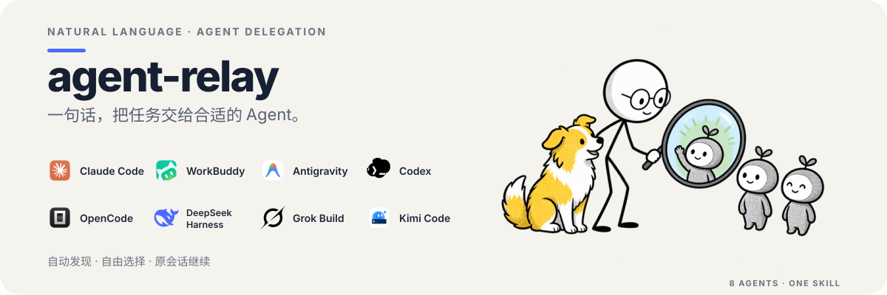

<p align="center">
  
</p>

# agent-relay

> 一句话把任务交给合适的 Agent：跨 8 大 CLI 智能体的统一任务中继与委托执行器。

`agent-relay` 让宿主 Agent（如 Google Antigravity、Claude Code 等）无需跳出终端，即可用自然语言将分析、审查、排查或编码任务委托给本机安装的其它外部 CLI Agent，并支持在原会话中无缝续接。

---

## 核心特性

- **零终端跳出**：直接在对话框使用自然语言下达指令，由宿主 Agent 自动执行中继脚本，无需手动切换终端窗口。
- **自动发现与静默探测**：首次运行自动扫描本机可用 Runner，不调用模型（0 Token 消耗）、不读取密钥凭据、不擅自安装或登录。
- **按工程角色路由（Role Routing）**：支持将审查、方案挑刺、疑难会诊、功能实现等角色分别绑定到不同 Agent；与 **`steamline`** 项目护航套件及 **`pstack`** 严谨工程流原生契合。
- **原会话精准续接（Session Resume）**：自动保存并追踪各 CLI 的 `session_id`，追问与返工时在原会话中继续，无需重复传递仓库背景。
- **严格凭据与安全边界**：不通过参数或提示词传递 API Key，沿用各 CLI 本地官方认证；默认读类角色强制只读沙箱。
- **独立可验证**：外部 Agent 的“自报成功”不作为交付依据，要求输出真实改动范围并由宿主 Agent 重新运行真实测试。

---

## 支持的 8 大 CLI Agent

支持全称及顺手简称，大小写不敏感：

| Agent | 常用简称 / 别名 | 认证方式 | 只读/修改权限映射 | 续接机制 |
|---|---|---|---|---|
| **Claude Code** | `cc`、`claude`、`claude-code` | 复用官方登录 | read: `--permission-mode plan`<br>write: `--dangerously-skip-permissions` | `--resume <session_id>` |
| **WorkBuddy** | `wb`、`codebuddy`、`cbc` | 复用官方登录 | read: `--permission-mode plan -y`<br>write: `bypassPermissions` | `--resume <session_id>` |
| **Antigravity** | `agy`、`antigravity`、`anti` | 复用官方登录 | read: `--mode plan`<br>write: `--dangerously-skip-permissions` | `--conversation <id>` |
| **Codex** | `codex` | 复用官方登录 | read: `--sandbox read-only`<br>write: `--dangerously-bypass-approvals-and-sandbox` | `codex exec resume` |
| **OpenCode** | `opencode` | 复用官方登录 | read: `--agent plan` + 进程权限拦截<br>write: 放开 edit/bash | `--session <session_id>` |
| **DeepSeek Harness** | `dsh`、`deepseek`、`deepseek-harness` | 复用 profile | read: `--permission-mode read-only`<br>write: `danger-full-access` | `--session-id <id>` |
| **Grok Build** | `grok`、`grok-build` | 复用官方登录 | read: `--permission-mode plan`<br>write: `--always-approve` | `--resume <sessionId>` |
| **Kimi Code** | `kimi`、`kimi-code` | 复用官方登录 | read: 明确拒绝（非交互非只读）<br>write: `-p` 原生 auto | `-S <session_id>` |

---

## 快速使用

### 1. 安装 Skill

在你的 Agent 对话中发送：

```text
请帮我安装这个 Skill：https://github.com/qiq-mine/agent-relay
```

或使用命令行安装：

```bash
npx skills add qiq-mine/agent-relay
```

### 2. 首次使用：自动探测与配置

首次调用时，系统会自动探测本机已安装的环境：

```text
你：用 cc 检查这个仓库的认证流程，找出潜在安全漏洞。
```

Agent 会自动运行静默扫描，展示发现的 CLI 及版本，并询问两个偏好：
1. **启用哪些 Agent？**（如 `claude,antigravity,codex`）
2. **默认使用哪一个，还是每次询问？**

确认后配置保存在 `~/.agent-relay/config.json`，不会写入或污染你的项目仓库。

### 3. 日常自然语言委托

配置完成后，直接对话即可派发任务：

```text
# 指定具体 Agent 执行分析（只读）
用 cc 检查这个仓库的登录流程，只读分析并告诉我问题在哪里。

# 指定 Agent 修改代码并验证
让 wb 修复这个测试用例，修改后运行 pytest 验证。

# 方案挑刺与审查
用 agy 评审这个设计方案，重点挑刺边界情况与风险。

# 续接上一次会话追问
让 cc 针对刚才发现的第 2 点漏洞给出具体的修复补丁，并在原会话中继续。
```

### 4. 按工程角色分工（Role Routing）

可将常见工程职责与特定模型或 Agent 进行长期绑定：

| 角色 (`--role`) | 用途 | 权限模式 | 契合工程实践 |
|---|---|---|---|
| `review` | 独立代码审查 | 强制只读 | `steamline` 审查 / `pstack interrogate` |
| `critique` | 动手前方案挑刺 | 强制只读 | `steamline readable-proposal` / `pstack reflect` |
| `diagnose` | 疑难问题双模型会诊 | 强制只读 | `steamline cut-losses` / `pstack attack-the-premise` |
| `implement` | 按方案编码实现 | 写入执行 | `steamline delegate-execute` / `pstack feature` |

只需在对话中指定一次：
```text
以后代码审查都交给 codex，方案挑刺用 claude，实现用你自己。
```
后续触发对应工作流时，系统会自动将任务分派给指定 Agent。

---

## 深度协同：Steamline 与 PStack

`agent-relay` 是连接多智能体工程套件的执行底座：

- **协同 [Steamline](https://github.com/qiq-mine/hch-skills-hub/tree/master/steamline)**：
  - 在 `readable-proposal` 阶段，调用 `critique` 角色由外部模型挑刺；
  - 在 `delegate-execute` 阶段，主对话只负责调度，派发给指定 CLI 编码实现；
  - 在 `cut-losses` 疑难止损阶段，通过 `diagnose` 角色调用 Slot 1 和 Slot 2 两个异构模型独立排查。
- **协同 [PStack](https://github.com/qiq-mine/hch-skills-hub/tree/master/pstack)**：
  - 为 `interrogate`（对抗审查）与 `arena`（多方案竞技）提供开箱即用的跨 CLI 进程调度能力。

---

## 自动化测试与质量保障

项目内置完整的单元测试套件，全面覆盖 8 种 Runner 的命令拼装、权限拦截、状态回退与会话续接逻辑：

```bash
python3 -m unittest discover -s tests -p "test_*.py" -v
```

测试执行结果：**23 tests passed (100% OK)**。

---

## 许可证

本项目基于 [MIT License](LICENSE) 开源。
包含源自 oil-delegate 的优秀核心设计并遵循其 MIT 许可声明。
