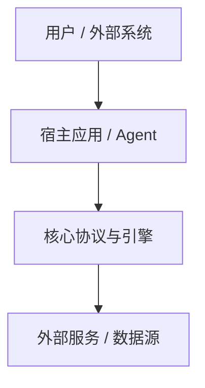

# {课程中文主题}（{Course English Title}）完整实战与架构指南

> 本指南基于 DeepLearning.AI 官方联合出品的课程 **《{Course English Title}》**（由 {Instructor Name & Title} 主讲）深度提炼而成。系统阐述了 ... 核心原理、技术方案选型、Mermaid 状态机与架构流转，以及生产级工业落地实践。

---

## 一、 课程核心认知体系与全景架构

### 1.1 核心问题与痛点背景剖析
- 传统方案的致命两难或瓶颈（如：$M \times N$ 接口碎片化、Naive RAG 的分块矛盾、无状态 Agent 上下文丢失）；
- 为什么必须引入新范式？核心破局思想。

### 1.2 范式跃迁全景架构图 (Architecture Diagram)



---

## 二、 核心原语与架构组件深度解析

### 2.1 核心模型三元组 / 原语对比

| 原语 / 模块 | 认知类比 | 系统映射 | 典型数据内容 | 读写更新机制 |
| :--- | :--- | :--- | :--- | :--- |
| **模块 A** | ... | ... | `code/text` | 实时读写 / 向量检索 |
| **模块 B** | ... | ... | `few-shot` | 少样本注入 |
| **模块 C** | ... | ... | `prompt` | 提示词自优化 |

---

## 三、 生产级端到端实战代码实现

### 3.1 环境初始化与命名空间配置
```python
# 核心依赖与初始化
```

### 3.2 核心业务逻辑与状态机实现
```python
# 状态机流转与执行循环
```

---

## 四、 工业级踩坑与最佳实践建议

1. **Token 与上下文控制**：...
2. **容错与超时恢复**：...
3. **安全与权限隔离**：...
